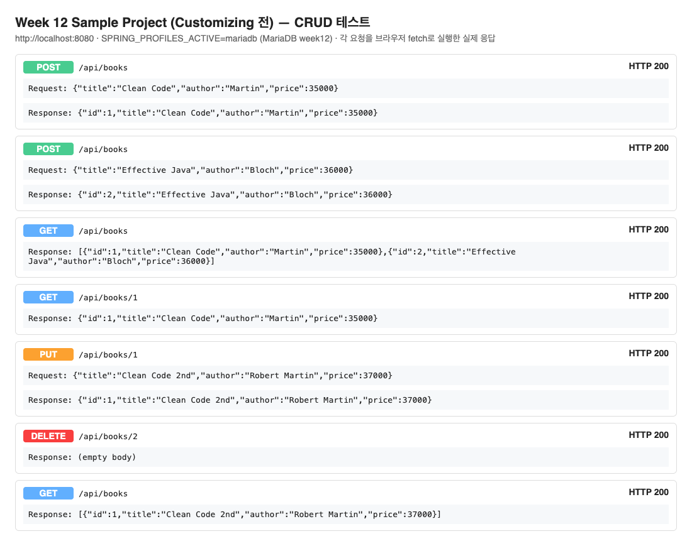
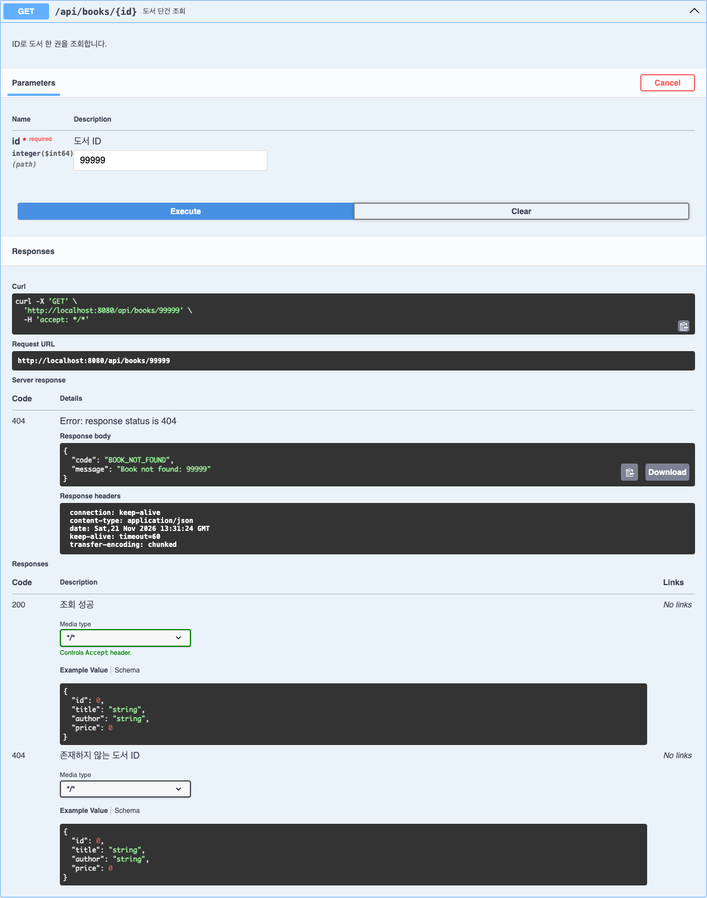
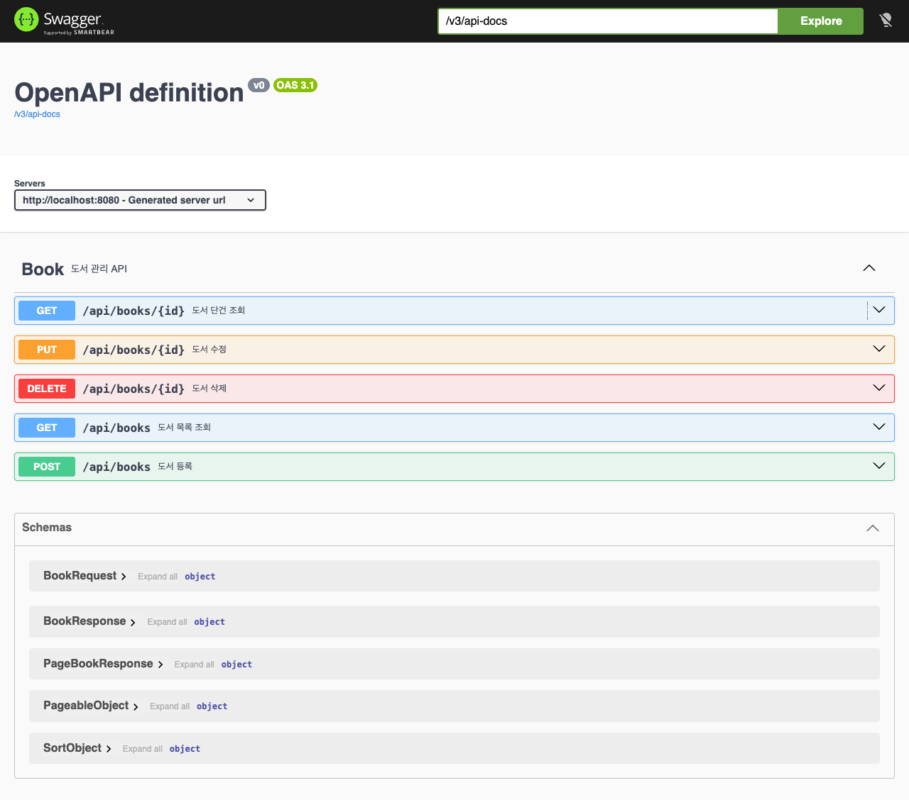

# Week 12 – Book REST API 고도화 및 API 문서화

- **GitHub Repository**: https://github.com/2026-2-WebService/assign12-c01-22300404
- **Render Deployment**: `https://<서비스이름>.onrender.com` ← 배포 후 기재
  - API: `https://<서비스이름>.onrender.com/api/books`
  - Swagger UI: `https://<서비스이름>.onrender.com/swagger-ui.html`

## 1. Project Information

제공된 Book REST API Sample Project(Spring Boot + JPA CRUD)를 12주차 강의 및 Lab 1~4 내용으로 고도화한 프로젝트입니다.

| 구분 | 적용 내용 |
|---|---|
| DTO | `BookRequest`(요청), `BookResponse`(응답) record로 Entity와 분리 |
| HTTP 응답 | `ResponseEntity`로 POST 201, GET/PUT 200, DELETE 204 |
| Validation | `@NotBlank`(title, author), `@Min(0)`(price) + `@Valid` |
| 예외 처리 | `@RestControllerAdvice` + `ApiError(code, message)` 공통 오류 응답 (400/404) |
| Pagination | `Pageable` + `Page<BookResponse>`, `@PageableDefault(size = 5, sort = "id")` |
| 문서화 | springdoc-openapi 2.10.0, `@Tag` / `@Operation` / `@ApiResponse` / `@Parameter` |

### 패키지 구조

```
src/main/java/edu/handong/week12
├── Week12Application.java
├── book
│   ├── Book.java                   # JPA Entity (books 테이블)
│   ├── BookRepository.java         # JpaRepository<Book, Long>
│   ├── BookService.java            # 비즈니스 로직, Entity ↔ DTO 변환, 404 예외 발생
│   ├── BookController.java         # REST API, ResponseEntity, Swagger 어노테이션
│   ├── BookRequest.java            # 요청 DTO (+ Validation)
│   ├── BookResponse.java           # 응답 DTO
│   └── BookNotFoundException.java  # 사용자 정의 예외
└── common
    ├── ApiError.java               # 공통 오류 응답 DTO (code, message)
    └── GlobalExceptionHandler.java # @RestControllerAdvice
```

## 2. Installation

- Java 17, Spring Boot 3.5.7, Gradle Wrapper 9.3.0 (포함됨)
- DB: 기본은 메모리 H2, `mariadb` 프로필에서 MariaDB 사용

### H2로 바로 실행

```bash
./gradlew bootRun
```

### MariaDB로 실행 (로컬)

```bash
# DB/계정 준비 (최초 1회) — 또는 docker compose up -d (포트 3307)
mariadb -e "CREATE DATABASE week12;
            CREATE USER 'week12'@'localhost' IDENTIFIED BY '<비밀번호>';
            GRANT ALL PRIVILEGES ON week12.* TO 'week12'@'localhost';"

SPRING_PROFILES_ACTIVE=mariadb \
DB_URL=jdbc:mariadb://localhost:3306/week12 \
DB_USERNAME=week12 \
DB_PASSWORD=<비밀번호> \
DDL_AUTO=update \
./gradlew bootRun
```

- 처음 실행할 때만 `DDL_AUTO=update`로 테이블을 만들고, 이후에는 `validate`를 권장합니다.
- DB 비밀번호는 코드나 설정 파일에 쓰지 않고 환경 변수로만 전달합니다. (`.env`는 `.gitignore`에 포함)

### 테스트

```bash
./gradlew test
```

`BookControllerTest`가 201/200/204, 400(검증 실패·잘못된 JSON), 404(조회·수정·삭제), 페이징/정렬, Swagger 노출을 확인합니다.

## 3. Source Code Exploration

> 이 섹션의 답변은 과제 규정에 따라 **생성형 AI 없이 직접** 작성합니다. 각 2~4문장, 관련 소스 파일과 메서드명을 함께 적습니다.

### Project Structure & JPA

**Q1. BookController, BookService, BookRepository의 역할과 요청 처리 흐름**

<!-- 직접 작성 (관련: BookController.create(), BookService.create(), BookRepository) -->

**Q2. `JpaRepository<Book, Long>`만 선언해도 `findAll()`, `save()`를 사용할 수 있는 이유**

<!-- 직접 작성 (관련: BookRepository) -->

### DTO & HTTP Response

**Q3. 기존 API가 Book Entity를 직접 요청·응답에 사용할 때 발생할 수 있는 문제**

<!-- 직접 작성 -->

**Q4. Request DTO와 Response DTO를 분리하는 이유와 ResponseEntity가 필요한 상황**

<!-- 직접 작성 -->

### Validation & Exception Handling

**Q5. `@Valid`, `@NotBlank`, `@Min`은 각각 어느 시점에 어떤 동작을 수행하나요?**

<!-- 직접 작성 -->

**Q6. `@RestControllerAdvice`와 `@ExceptionHandler`를 사용하면 예외 처리 흐름이 어떻게 바뀌나요?**

<!-- 직접 작성 -->

### Pagination & OpenAPI

**Q7. `Pageable`과 `Page<T>`의 역할, `sort=price,desc` 처리 방식**

<!-- 직접 작성 -->

**Q8. `/v3/api-docs`와 `/swagger-ui.html`의 역할 구분**

<!-- 직접 작성 -->

### 줄 단위 설명 주석을 작성한 메서드 3개

| 메서드 | 파일 | 설명 포인트 |
|---|---|---|
| `BookController.create()` | `src/main/java/edu/handong/week12/book/BookController.java` | `@Valid`, DTO, `ResponseEntity`, 201 응답 |
| `BookService.findById()` | `src/main/java/edu/handong/week12/book/BookService.java` | Repository 조회, `Optional`, 404 예외 발생 |
| `BookController.list()` | `src/main/java/edu/handong/week12/book/BookController.java` | `Pageable`, `Page`, DTO 변환 |

> 각 메서드의 `// TODO(직접 작성)` 위치에 주석을 작성합니다.

## 4. Refactoring – DTO와 ResponseEntity 변경 전/후

### 코드 변경

| 구분 | 변경 전 (Sample) | 변경 후 |
|---|---|---|
| 요청 타입 | `@RequestBody Book input` (Entity) | `@Valid @RequestBody BookRequest request` |
| 응답 타입 | `Book`, `List<Book>` (Entity) | `ResponseEntity<BookResponse>`, `ResponseEntity<Page<BookResponse>>` |
| 삭제 응답 | `void` | `ResponseEntity<Void>` (`noContent()`) |
| 없는 ID | `orElseThrow()` → `NoSuchElementException` | `orElseThrow(() -> new BookNotFoundException(id))` |

```java
// 변경 전
@PostMapping
public Book create(@RequestBody Book input) {
    return service.create(input);
}

// 변경 후
@PostMapping
public ResponseEntity<BookResponse> create(@Valid @RequestBody BookRequest request) {
    BookResponse saved = service.create(request);
    return ResponseEntity
            .status(HttpStatus.CREATED)
            .body(saved);
}
```

### API 요청/응답 차이

| 요청 | 변경 전 | 변경 후 |
|---|---|---|
| `POST /api/books` | `200 OK` | `201 Created` + `BookResponse` |
| `POST` 본문에 기존 ID `"id": 1` 포함 | `200 OK`, **기존 1번 도서가 덮어써짐** | `BookRequest`에 `id`가 없어 무시, 새 ID로 생성 (`201`) |
| `POST` 본문에 없는 ID `"id": 999` 포함 | `500` (`StaleObjectStateException`) | `id` 무시, 새 ID로 생성 (`201`) |
| `GET /api/books` | 전체 목록 JSON 배열 `[...]` | 페이지 객체 `{ "content": [...], "totalElements", "totalPages", "number", "size", ... }` |
| `GET /api/books/99999` | `500 Internal Server Error` (`NoSuchElementException`) | `404` `{"code":"BOOK_NOT_FOUND","message":"Book not found: 99999"}` |
| `DELETE /api/books/{id}` | `200 OK` (빈 본문) | `204 No Content` |
| `DELETE /api/books/99999` | `200 OK` (없는 ID도 성공처럼 응답) | `404` `BOOK_NOT_FOUND` |
| `POST` `{"title":"","author":" ","price":-1000}` | 검증 없이 저장됨 (`200`) | `400` `VALIDATION_FAILED` |

> 변경 전 결과는 원본 Sample 커밋(`3faf455`)을 H2로 실행해 확인한 값입니다.

변경 후 `POST` 응답 예시:

```http
POST /api/books
Content-Type: application/json

{"id":999,"title":"DDD","author":"Evans","price":45000}
```

```http
HTTP/1.1 201 Created

{"id":8,"title":"DDD","author":"Evans","price":45000}
```

> Lab 1 단계에서 `BookResponse.from()`이 `author` 자리에 `book.getTitle()`을 넣고 있어 응답의 author가 제목으로 나오던 오류도 함께 수정했습니다.

## 5. New Features

### Validation

```java
public record BookRequest(
        @NotBlank(message = "제목은 필수입니다.")
        String title,
        @NotBlank(message = "저자는 필수입니다.")
        String author,
        @Min(value = 0, message = "가격은 0 이상이어야 합니다.")
        int price
) {}
```

POST와 PUT 모두 `@Valid`를 적용했습니다.

### 공통 예외 처리

`GlobalExceptionHandler`(`@RestControllerAdvice`)가 예외를 `ApiError(code, message)` JSON으로 변환합니다.

| 예외 | 상황 | 상태 | code |
|---|---|---|---|
| `BookNotFoundException` | 없는 ID 조회/수정/삭제 | 404 | `BOOK_NOT_FOUND` |
| `MethodArgumentNotValidException` | 빈 제목/저자, 음수 가격 | 400 | `VALIDATION_FAILED` |
| `HttpMessageNotReadableException` | JSON 문법 오류, 타입 불일치 | 400 | `INVALID_JSON` |

```json
{"code":"VALIDATION_FAILED","message":"price: 가격은 0 이상이어야 합니다., title: 제목은 필수입니다., author: 저자는 필수입니다."}
```

### Pagination / Sorting

```
GET /api/books?page=0&size=5&sort=price,desc
```

- 파라미터를 생략하면 `@PageableDefault(size = 5, sort = "id", direction = ASC)`가 적용됩니다.
- `Page<BookResponse>`를 반환하므로 `content`와 `totalElements`, `totalPages`, `number`, `size` 등 페이징 메타데이터가 함께 응답됩니다.
- Spring Data 3.3 이상은 `PageImpl`을 그대로 직렬화하면 "JSON 구조 안정성이 보장되지 않는다"는 WARN 로그를 남깁니다. 강의 예제와 같은 응답 구조를 유지하기 위해 `Page`를 그대로 반환했습니다.

### Swagger / OpenAPI

- 의존성: `org.springdoc:springdoc-openapi-starter-webmvc-ui:2.10.0`
- Swagger UI: http://localhost:8080/swagger-ui.html
- OpenAPI JSON: http://localhost:8080/v3/api-docs
- `@Tag(name = "Book")`, 전체 5개 API에 `@Operation`, `@ApiResponse`, `@Parameter` 적용

## 6. Testing & Deployment

### Local Testing 결과 (`results/`)

| 파일 | 내용 |
|---|---|
|  | 01 – 초기 Sample CRUD 테스트 |
|  | 02 – DTO 적용 후 POST 성공 (201) |
|  | 03 – 잘못된 입력 요청 (400) |
|  | 04 – 존재하지 않는 ID (404) |
|  | 05 – 페이지/정렬 적용 결과 |
|  | 06 – Swagger UI / API 테스트 화면 |

### Render 배포

Render에는 Java 런타임이 기본 제공되지 않으므로 `Dockerfile`로 배포합니다.

1. Render → **New Web Service** → 이 GitHub 저장소 연결 → Runtime: **Docker**
2. Environment Variables 설정 (비밀번호는 Render 대시보드에만 입력)

   | Key | Value |
   |---|---|
   | `SPRING_PROFILES_ACTIVE` | `mariadb` |
   | `DB_URL` | `jdbc:mariadb://<외부 DB 호스트>:<포트>/<DB명>` |
   | `DB_USERNAME` | `<DB 계정>` |
   | `DB_PASSWORD` | `<DB 비밀번호>` |
   | `DDL_AUTO` | 최초 배포 `update` → 테이블 생성 후 `validate` |

3. `PORT`는 Render가 주입하며 `application.yml`의 `server.port: ${PORT:8080}`이 사용합니다.
4. 배포 후 확인: `/api/books`, `/swagger-ui.html`

### 배포 중 발생한 문제와 조치

<!-- Render에서 외부 MariaDB 연결 시 발생한 실제 오류 메시지와 조치 내역을 기록합니다. 예: 접속 거부(방화벽/허용 IP), 인증 실패, 테이블 없음(DDL_AUTO) 등 -->

| 오류 (로그 원문) | 원인 | 조치 |
|---|---|---|
| | | |

## 7. Weekly Review

> 과제 규정에 따라 직접 작성합니다.

**새롭게 배운 내용 3가지**

1.
2.
3.

**어려웠던 점과 해결 방법**

**AI 활용 내용 및 느낀 점**
